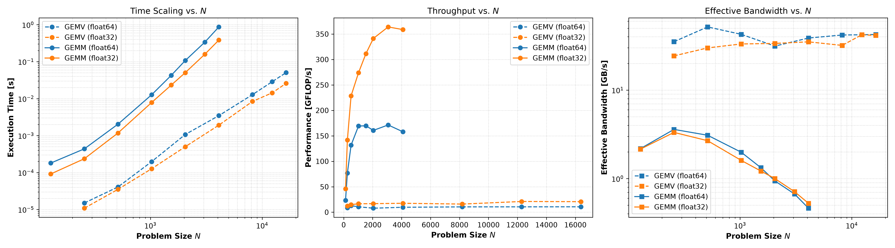
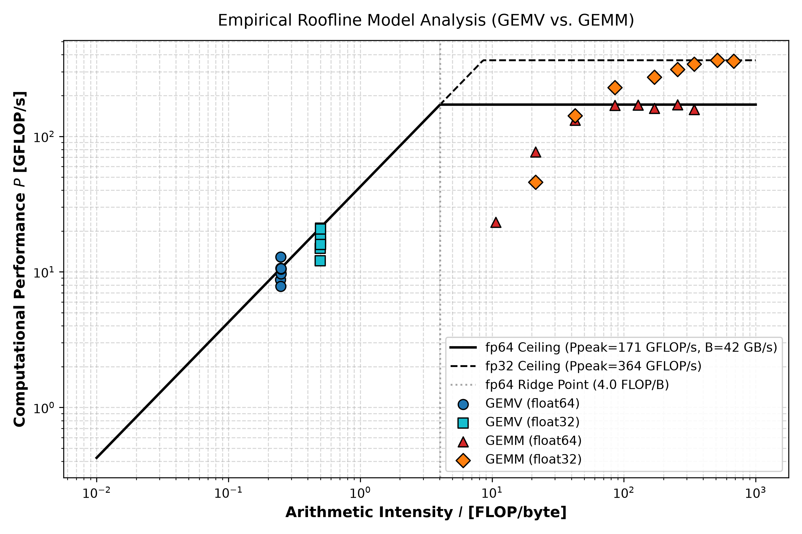

# Roofline Model Performance Analysis

## 4. Experimental results

The benchmark results for matrix–vector and matrix–matrix multiplication are shown below. The plots compare execution time and computational performance across different matrix sizes and data types.

The Roofline analysis is shown below. It compares the measured performance and arithmetic intensity with the estimated performance ceilings.

In the Roofline plot, the GEMV points lie to the left of the 5 FLOP/byte ridge point, suggesting memory-bound behaviour. The GEMM points lie to the right, suggesting more compute-bound behaviour. Both operations remain below the theoretical performance ceilings, as expected for NumPy measurements on this computer.

As the matrix size increases, matrix–matrix multiplication takes longer than matrix–vector multiplication. However, matrix–matrix multiplication generally achieves higher computational performance because it performs more operations for each amount of data transferred and reuses matrix values.

The results also show that `float32` generally achieves higher performance than `float64` for matrix–matrix multiplication. Matrix–vector performance varies more between sizes. Some measurements are very short, so timing overhead, caching, and other system activity may affect the results.

The measured points remain below the theoretical Roofline ceilings. The Roofline model provides idealised limits, while the benchmark measures NumPy performance on this computer.

## 5. Discussion

### 5.4 Are there any unexpected results?

The results do not increase smoothly for every matrix size. In particular, some matrix–vector performance values fluctuate, and float64 is not always slower than float32. This may be because some measured times are extremely short, so timer overhead, caching, and other system activity can affect the results. The bandwidth values are also estimates based on the assumption that each input and output array is transferred once; actual memory traffic may differ because of caching and NumPy's implementation. Therefore, the overall trends are more reliable than individual measurements.

